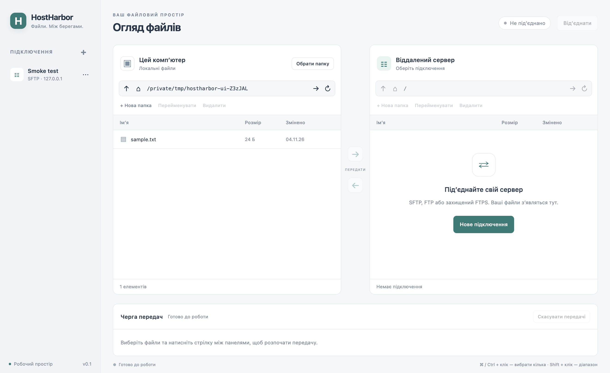

# Local validation — HH-001

Environment: macOS 26.6.2 arm64, project-local Node 22.23.4, Electron45.2.1. Date: 2026-11-04.

- `npm ls --depth=0`: pinned top-level dependencies installed.
- `npm run check`: JavaScript syntax passed.
- `npm test`: 14/14 passed (paths, credential persistence with encryption double, SSH trust policy, filesystem symlinks, recursive transfer, overwrite decline, failure/cancellation).
- `npm run test:integration`: 9/9 real disposable SFTP/FTP/explicit FTPS checks passed. Nested binary files, zero-byte files, empty folders, staged overwrite, CRUD; rejected first/changed SSH key before password auth; rejected untrusted TLS and verified encrypted trusted TLS transfer.
- `npm run test:ui`: actual Electron renderer loaded, Node API absent, local navigation and first saved profile passed. OS encryption availability true.
- Native safeStorage smoke: synthetic password encrypted to disk, absent from plaintext JSON; a second Electron process decrypted it successfully. This isolated test was run separately; production credentials were never used.
- `npm run package:mac`: unsigned arm64 HostHarbor.app built. UI smoke also passed against the packaged executable.
- `npm audit --omit=dev`: 0 reported runtime dependency vulnerabilities at validation time.

## Limits
No real hosting provider, Intel Mac or Windows tested. Distribution signing/notarization not performed. Native trust/delete/overwrite dialogs source-inspected; not all manually clicked in end-to-end UI. Independent reviewer also reproduced encrypted SSH-key login, FTPS hostname rejection, and real SFTP/FTP upload cancellation preserving originals; these scenarios are retained in the integration suite. Exhaustive network-drop conditions remain untested. safeStorage uses working but deprecated sync APIs on pinned Electron45; migration needed before upgrading to46. Local fixture is not exhaustive interoperability evidence. Independent review and CI status are separate gates.

